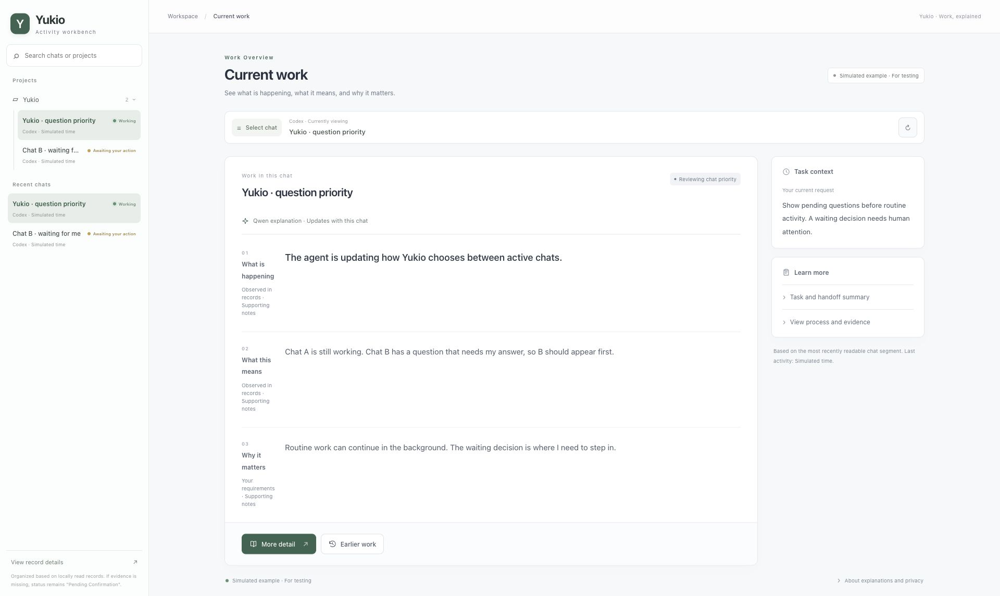
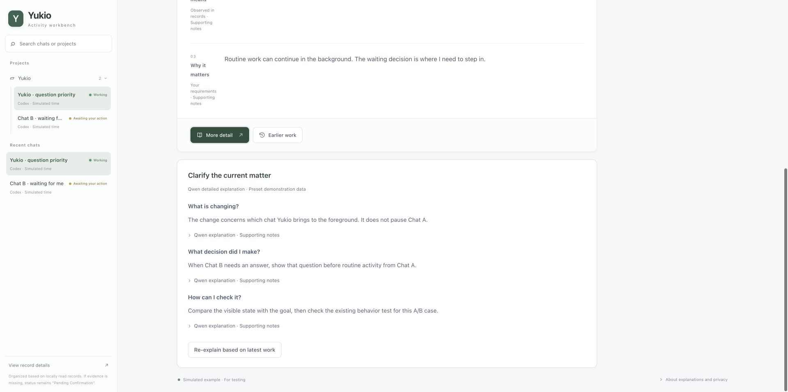
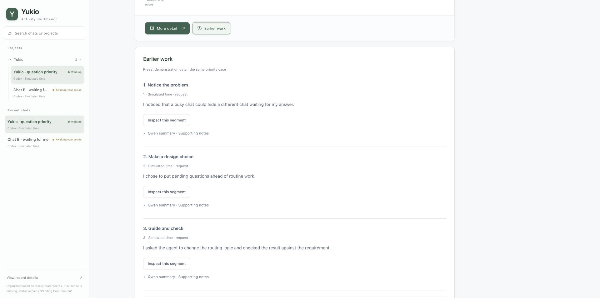

# Yukio

### A desktop companion for coding with AI.

**See your agents at work. Understand the progress. Step in when it matters.**

**English** · [简体中文](README.zh-CN.md)

[Download](#download) · [Features](#features) · [Character & animation gallery](#character--animation-gallery) · [Get started](#get-started)

Yukio brings AI-assisted development onto your desktop with an animated companion and a clear view of the work behind it. Follow **Codex, Claude Code and DeepSeek's Deep Code CLI**, catch the moments that need your attention, and explore what the agent is doing through the integrated **Mac activity workbench**.

The character keeps progress in view while you work. The workbench helps you pick up the context, inspect an explanation and decide what to do next.

## Features

| Stay in the flow | Take a closer look |
| --- | --- |
| **Live activity, expressed through animation.** Twelve distinct states turn reading, writing, testing and other agent activity into a glanceable desktop presence. | **Work explained in everyday language.** The Mac workbench brings together the current action, its context and why it matters. |
| **Attention where it counts.** Pending questions, blocking errors and completion notices take priority over routine activity. | **Projects and conversations, organized.** Browse projects, return to recent chats and search locally, with status shown beside each conversation. |
| **Respond beside the character.** Answer supported questions and review approval requests through connected chat cards. | **Context you can revisit.** Open a deeper explanation or browse earlier work grouped by your requests, with expandable supporting excerpts. |

### Your agents, at a glance

Yukio follows local activity from all three supported agent families. Choose one source, use **Auto** to follow them together, or pin a conversation. A compact speech bubble shows the chat title, current step and task-list progress when available.

When several chats are active, the others appear as stacked cards. Expand the stack to switch conversations; supported chat links take you back to the relevant destination.

### Understand the work as it happens

Right-click the character on Mac to open the activity workbench. Its home view answers three questions: **What is happening? What does this mean? Why does it matter?** With a configured model, explanations can refresh as the selected conversation progresses while the workbench is open.

Choose **More detail** to explore the current work, its purpose, results and unclear parts. Choose **Earlier work** to revisit short summaries organized by user request, then expand the segment you want to inspect. Supporting excerpts let you compare an explanation with the recorded activity.

<table>
<tr>
<th width="50%">Go deeper</th>
<th width="50%">Pick up where you left off</th>
</tr>
<tr>
<td></td>
<td></td>
</tr>
</table>

Workbench images use the current interface with preset demonstration data. Click an image to view it at full size. Model explanations require a compatible configured service.

### Be there when your input is needed

Question cards keep the prompt and answer close to the character. Connected Codex desktop chats on macOS can receive answers in the background, so you can keep your focus. Failed sends preserve your text for retry. Approval cards show the full request before you choose whether to proceed.

Completion reminders help you return to finished work. Questions and approvals remain pending until handled; opening a chat does not answer or approve them.

Reply support depends on the source and its connection. See the [connection guide](YukioPlayer/Resources/BACKGROUND-ANSWERS.md) for setup and supported routes; web and browser-plugin connections are experimental.

## Character & animation gallery

### Two companions. One workspace.

Choose a look that fits your desktop. **Yukio (雪绪)** pairs white hair and blue eyes with a navy uniform. **Qianxia (千夏)** brings mint-green hair, pink accents and playful electronic details. Both include twelve activity animations, independent blinking and a dedicated picked-up pose.

<table>
<tr>
<th width="50%">Yukio · 雪绪</th>
<th width="50%">Qianxia · 千夏</th>
</tr>
<tr>
<td align="center"></td>
<td align="center"></td>
</tr>
<tr>
<td align="center">Quiet colors. A familiar desk companion.</td>
<td align="center">Bright details. A playful change of pace.</td>
</tr>
</table>

### Twelve ways to show the work

Reading becomes a book. Editing becomes a moving pen. Image inspection becomes a magnifying glass. Testing, browsing, questions and completion each have their own visual language.

### Small motions, full of character

The pen follows the page, the magnifier moves across an image, and the hands take turns at the keyboard. Independent blinks and reading gaze add life to each activity. Pick the character up and she swings with your movement, then settles after release.

The previews above show the animation artwork and drag behavior. The artwork uses reviewed transparent layers and coordinated hand-and-prop motion. Explore the [animation inputs and workflow](sources/approved-animation-rig/README.md).

Adjust the character from **50% to 200%**, drag her to a comfortable spot, switch skins, or enable **Hide when idle** for a quieter desktop. English and Chinese interfaces are available; real chat names and quoted source text retain their original language.

## Download

| Platform | Download | Included experience |
| --- | --- | --- |
| **Apple silicon Mac · macOS 13+** | **[v0.4.11 DMG](https://github.com/leozhang8654/yukio-desktop-pet/releases/download/v0.4.11/Yukio-0.4.11-macOS-arm64.dmg)** · [ZIP](https://github.com/leozhang8654/yukio-desktop-pet/releases/download/v0.4.11/Yukio-0.4.11-macOS-arm64.zip) | Desktop companion + integrated activity workbench |
| **Intel Mac** | [v0.4.6 DMG](https://github.com/leozhang8654/yukio-desktop-pet/releases/download/v0.4.6/Yukio-0.4.6-macOS.dmg) · [ZIP](https://github.com/leozhang8654/yukio-desktop-pet/releases/download/v0.4.6/Yukio-0.4.6-macOS.zip) | Earlier desktop companion release |
| **Windows 10 / 11 · 64-bit** | [v0.4.6 Setup](https://github.com/leozhang8654/yukio-desktop-pet/releases/download/v0.4.6/Yukio-0.4.6-Windows-Setup.exe) · [Portable ZIP](https://github.com/leozhang8654/yukio-desktop-pet/releases/download/v0.4.6/YukioDesktop-win-Portable.zip) | Earlier desktop companion release |

The integrated workbench is currently available on Apple silicon Mac. Intel and Windows downloads remain on v0.4.6. For the current Mac version, install the complete DMG or ZIP; automatic installation remains under review. [All releases and checksums](https://github.com/leozhang8654/yukio-desktop-pet/releases).

<b>First launch on macOS or Windows</b>

On Mac, open the DMG, drag `Yukio.app` into **Applications**, then launch it. The Mac build is ad-hoc signed and is not Apple-notarized. If macOS blocks a download you trust, use **System Settings → Privacy & Security → Open Anyway** after the first launch attempt.

On Windows, run Setup and open the installed shortcut. The Windows executable is unsigned; SmartScreen may display **More info → Run anyway**. Verify the download source and release checksum before proceeding.

## Get started

1. **Launch Yukio.** Choose your character, language and size in pet settings. **Play demo** gives you a tour of the activity animations.
2. **Start your coding agent.** Choose Codex, Claude Code, Deep Code or Auto in the assistant setting. Yukio reads the supported local activity records as work progresses.
3. **Open the workbench on Mac.** Right-click the character, choose a project or recent chat, and explore its current work. Pet settings are available from the workbench's upper-right corner.
4. **Connect the features you want.** Use the [reply setup guide](YukioPlayer/Resources/BACKGROUND-ANSWERS.md) for question cards and the [model configuration guide](docs/activity-workbench-model-configuration.md) for richer explanations. Basic activity following works without an explanation model.

## Your work, handled with care

Activity monitoring and local search run on your computer. Optional model explanations send limited excerpts from the selected conversation to your configured service. The current explanation adapter supports a local or LAN OpenAI-compatible endpoint without API-key authentication. Closing the workbench stops new explanation requests; a request already sent may still finish.

Explanations are based on the activity that is available. They can be incomplete or mistaken, so supporting excerpts and missing-context notices stay accessible. Connection details and personal activity history are not included in the download.

## Explore the project

[Documentation](docs/README.md) · [macOS source & build guide](YukioPlayer/README.md) · [Windows source & build guide](YukioWin/README.md) · [Release notes](CHANGELOG.md) · [Report an issue](https://github.com/leozhang8654/yukio-desktop-pet/issues)

Yukio combines a native **Swift / AppKit** Mac companion, a **Python** Windows companion and a **Python / JavaScript** activity workbench. Character artwork, animation inputs and the player source live in this repository.
