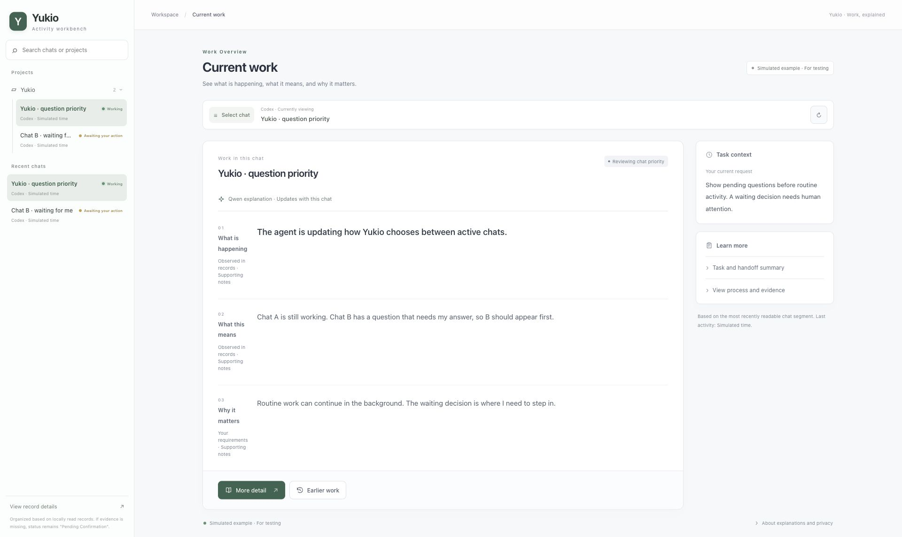

# Yukio · 雪绪

### 让 AI 的工作看得见。

Mac 桌面伙伴：用角色动作呈现工作状态，用自然语言解释进展，在需要你时提醒你。

[English](README.md) · **简体中文**

**[下载 Mac 预览版](https://github.com/leo-zhang-source/yukio-desktop-pet/releases/tag/v5.4-preview.1)** · [快速上手](docs/MAC-USER-GUIDE.zh-CN.md) · [在线动画演示](https://is.gd/yukioapp)

## 为什么做 Yukio

AI 同时处理多个任务时，用户往往需要反复切换聊天，才能知道它做到哪一步、是否在等自己。Yukio 把这些信息带到桌面，让进展和需要介入的时刻更容易被看见。

## 功能亮点

- **状态可见**：十二种动作对应阅读、写代码、测试、等待回答等状态；支持雪绪与千夏两位角色。
- **进展可读**：工作台呈现当前工作、原因与历史，支持 AI 解释，并提供原文依据供核对。
- **多聊天提醒**：集中展示不同聊天的状态，可切换关注对象，发现待回答和已结束的任务。
- **就近回应**：连接支持的助手后，可在角色旁回答问题、查看并决定批准申请。

支持跟随本机 **Codex、Claude Code 和 Deep Code**。AI 解释使用用户自己的 Codex 或 Claude Code 账号。

工作台示意：使用较早界面与演示数据，实际布局以安装版本为准。

## 开始体验

1. **安装**：打开 DMG，把 `Yukio.app` 拖到“应用程序”并启动。
2. **看动画**：右键角色打开工作台，进入雪绪设置，选择“播放演示”；也可以拖动、缩放或更换角色。
3. **看真实工作**：停止演示、开启“跟随助手活动”，在本机编程助手中开始一个小任务，再到工作台选择该聊天。

想体验工作解释和问题回传，按[快速上手](docs/MAC-USER-GUIDE.zh-CN.md)连接自己的助手。

## 下载与使用范围

面向 **Apple 芯片 Mac，macOS 13+**，支持中英文。本次提供 **5.4 Preview 1（55）**，保留桌面现用工作台界面，并更新 Agent 解释、Codex 客户端识别和中英文说明。预览版仍在测试；Windows 与云端 Cowork 暂缓。

当前包尚未公证，首次打开方法见[安装说明](docs/MAC-HELP.zh-CN.md#install)。旧版需手动安装一次；更新请看[当前方法](docs/MANUAL-UPDATES.md#zh)。

活动记录与搜索在本机处理；开启 AI 解释会发送相关聊天短摘录，并使用所选账号额度。

## 技术与资料

原生 **Swift / AppKit** 桌面角色，搭配 **Python / JavaScript** 活动工作台；动画采用透明图层、局部运动与独立眨眼。

[本次更新](docs/releases/5.4-preview.1.md) · [使用与排错](docs/MAC-HELP.zh-CN.md) · [文档导航](docs/README.zh-CN.md) · [源码与构建](docs/remediation/MAC-BUILD.md) · [开发与验收记录](DEVELOPMENT.md) · [反馈问题](https://github.com/leo-zhang-source/yukio-desktop-pet/issues)
