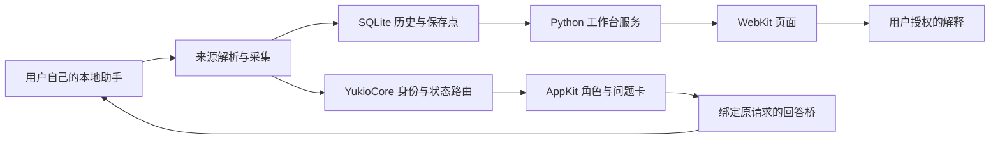
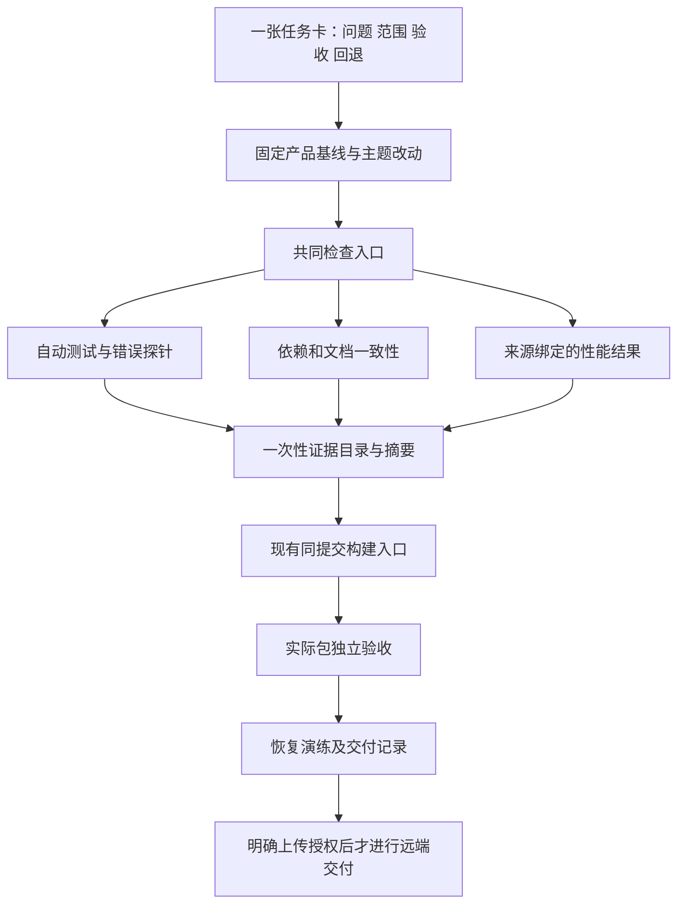

# 架构方案与主要技术决策（2026-11-07 已批准本地实施）

建议采用路线 B：保持产品架构与现用界面，以 Preview 2 产品源码为后续维护基线，逐主题接入整改成果，再为现有测试、构建和归档增加共同的维护入口。用户已批准 M0–M5 的本地实施；实际改动和验证见 IMPLEMENTATION/TEST_RESULTS。M6 独立验收仍暂停，远端写入未授权。

## 路线比较

| 路线 | 创新/成熟度 | 性能与兼容 | 成本与可维护性 | 判断 |
| --- | --- | --- | --- | --- |
| A：只补文档与人工检查表 | 改动最小，手工流程成熟 | 不影响运行，但不能阻止漏测/旧证据错用 | 初期低，长期依赖记忆且重复核对 | 不足以满足本次长期维护目标 |
| B：现有架构 + 可执行维护检查 + 有证据的局部修复 | 成熟模块与标准库；新 lockfile 能力另做小实验 | 产品无新增常驻服务；保留现有数据/界面；逐主题验证性能 | 中等一次性投入，复用已有 runner/build/模板 | 推荐 |
| C：重写 Swift 架构/更换 Web 层/拆微服务或云控制台 | 新技术多，项目内未经验证 | 迁移、焦点、并发、账号和存储风险同时增大 | 高开发与长期运维成本，暂无测量支持 | 本阶段不采用；若未来明确瓶颈再提案 |

依据：小批量交付和工作流研究支持细粒度反馈，[R1–R3](RESEARCH_LOG.md)；本轮两线性能差异证明已有局部方案值得先试，不能据此断言某一个函数解释了全部差异。

## 运行架构保持边界

代码整理围绕现有边界开展，不增加运行时维护代理，不将 NAS 接到用户 App。所有来源在客户端提供可靠 ID 时记录来源/会话/轮次/调用/运行代次；关系缺失显示限制，不靠时间或名称猜测父子关系。

## 开发与维护架构

| 组件（拟实现） | 职责与输入/输出 | 明确不承担 |
| --- | --- | --- |
| 维护状态登记 | 当前产品线、提交、受保护资源、支持范围、未验收项；一个事实只登记一处 | 不用一个 build 号代替源码和包身份 |
| 扩展现有 runner | 测试清单与发现结果核对、未知/空/跳过/超时失败、源指纹稳定、退出码 | 不改写已失败报告、不靠测试数量自证产品质量 |
| 轻量维护校验器 | 读取锁文件/版本配置/文档链接/证据摘要，生成机器报告与一页摘要 | 不自建包管理器、漏洞数据库或第二套测试调度系统 |
| 兼容台账 | 客户端/系统版本、身份能力、对应 MC 场景、真实包证据、待验边界 | 不从某客户端 4 聊天推断无限并发或其他客户端兼容 |
| 恢复验证 | 人工数据先演练，再按授权对包与一致性快照回读；记录 schema 和新增记录 | 不自动恢复旧数据库覆盖现用数据，不自动删文件 |

## 决策 D1：产品基线与迁移

本轮审查仍遵守指定整改入口；批准后，将后续产品改动明确基于当前发布工作树的 `2701916b`（产品源码来自 `bc95722e`）。先确认工作区未被其他任务改变，记录本地恢复点。整改线保留为候选/证据库，按功能挑选差异，禁止整体合并 UI 或覆盖现用 App。DEVELOPMENT 的当前入口说明一起更新，历史段落明确标历史。

先移植维护工具与回归用例，再选择设置依赖、问题状态、时间解析等独立改动。每个主题只认新的发布线验证结果。原有素材/界面建立哈希与可见行为保护，必要产品修复只动已确认区域。

## 决策 D2：检查与验收分层

证据按四层记录：源码自动检查、包内检查、独立实际流程、公开交付。摘要包含源码完整提交/工作区指纹、工具与系统、场景、执行命令、退出码、测试/跳过数量；有包时绑定包 SHA-256。历史摘要只作为历史，不能填充当前层缺失字段。

保留已有“故意错误断言”和“过时已知问题”探针，新增门槛反例：漏登记测试、空套件、未知输出、未批准跳过、源码变化、错提交、错包、无独立证据。证明每一项被拒绝后才信任维护门槛。原生 UI 检查串行；首次失败保留，允许为定位复测，禁止只保留重跑成功。[R2–R3](RESEARCH_LOG.md)

现有本机测试不能因隔离 HOME 而升级成独立用户验收。远端保护规则本轮没有查询或配置；历史“main 未保护”只是历史，后续获准时重新核实并用真实失败验证阻止合并。

## 决策 D3：依赖更新与工作流

保留 pip 固定版本/全依赖哈希/只用 wheel 与 Swift 锁文件；不因引入维护机制顺带升级整套依赖。`scripts/macos-release.json`、锁文件和包内依赖清单互相核对；CPython、Sparkle、PyInstaller bootloader、系统依赖与外部助手分别记录。[R4、R7、R8](RESEARCH_LOG.md)

GitHub 2026-10-28 GA 的 Actions lockfile 能覆盖传递 action 依赖，作为优先试验；使用官方 `gh-actions-lock` 生成，不能手填。只选 Mac 工作流先试，锁文件过期/缺项必须失败；可复用 workflow 仍需固定完整 SHA。若工具或托管端不兼容，采用完整 SHA 固定并登记传递依赖这一成熟备选。远端运行与强制策略待上传授权后验证，本地配置不能宣称云端保护已生效。[R5–R6](RESEARCH_LOG.md)

依赖评估先人工触发本地报告；Python 已知漏洞可用固定版本 pip-audit，只报结果、不 `--fix`。它不能覆盖 CPython/原生库的全部问题，后者检查官方公告；网络失败记“未知”。Dependabot 和 Renovate 作为远端备选比较：当前依赖规模优先原生 Dependabot 的分组评估，只有自定义归档锁定需求确实超出时才考虑 Renovate；两者本轮均不安装/启用、不自动开 PR。[R9–R10](RESEARCH_LOG.md)

Sparkle 2.10.1 的 Unicode 路径更新修复作为单独兼容评估任务；本轮没有证明 Yukio 受影响，也不把上游修复自动等同安全漏洞。[R7](RESEARCH_LOG.md)

## 决策 D4：性能与小步整理

复用四聊天、三负载、每类三遍样例。沿用历史读取调用阈值 idle ≤5 ms、normal ≤25 ms、burst ≤100 ms；本轮发布线 burst 明确不达标。先单独移植时间解析优化，运行旧格式/毫秒/并发解析回归，并重新做同机对照。当前跨线结果不足以证明该单一补丁能达到同样效果。

调用阈值只是历史读取基准。Apple 将离散输入响应与连续渲染分开；46–48 ms 仍可能影响动画帧，不能写“已流畅”。后续记录主线程时段、事件到显示延迟、hitch、进程/内存趋势及 30 分钟实际交互；在实验前记录候选目标（输入到反馈 P95 <100 ms、Yukio 自身主线程阻塞无 ≥250 ms；连续渲染单独报告）。若局部优化仍不满足实际体验，再提一次只迁移一个来源的受限后台读取，保留取消代次、顺序和退出所有权。[R11–R12](RESEARCH_LOG.md)

## 决策 D5：数据保护与恢复

保持现有 SQLite schema 1/2 兼容与事务。维护快照通过 SQLite backup API，或停止自有写入者后的一致性复制；不能裸复制正在写入的单个数据库文件。备份超时保留失败和原件，避免无限重试。先在人工数据验证新增记录/来源保存点/完整性，再申请真实数据范围的恢复操作。[R13](RESEARCH_LOG.md)

应用回退与数据回退分开：旧程序可读当前 schema 时先仅回退 App；不兼容时保留当前库和新增资料，进入单独迁移任务。发布包与公开证据、私有日志/数据库/凭据分区；密钥不进入包、仓库或 NAS 项目归档。

## 决策 D6：维护节奏与可交接性

采用 [MAINTENANCE](MAINTENANCE.md) 的触发式日常流程与按期复核目标。沿用一页任务卡，不复制多套状态表；机器报告生成摘要，人的说明只补原因和范围。没有常驻维护服务、计划任务或自动上传；如需无人值守巡检，另行明确频率、账号、输出和授权后设置。

风险缓解：先以一项真实小修复验证完整流程；若维护文件重复或流程比修复更复杂，保留唯一登记与五项任务卡字段，删去冗余流程设计。这里的复核是同一执行者的批判性自审，尚无第二位独立评审者，不能写“独立评审通过”。
